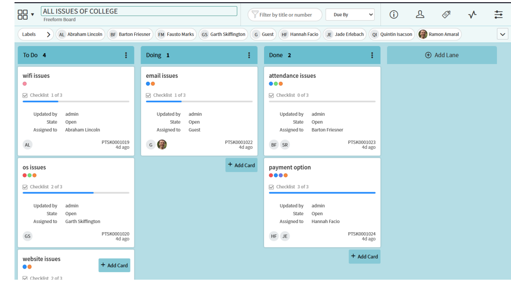
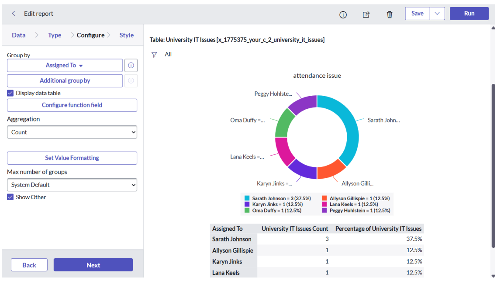

# Track My Issue: University IT Issue Tracking on ServiceNow

ServiceNow ITSM mini-project that simulates a campus IT helpdesk, where students and staff report IT issues and the IT team tracks them from incident to resolution.

**Live demo:** <!-- TODO: add a link to a short screen recording (e.g. YouTube/Loom). ServiceNow developer instances are private, so a video is the best "live" demo. --> _Video walkthrough coming soon_ · **Full project report:** [TrackMyIssue.pdf](TrackMyIssue.pdf)



## Features

- **Users and roles:** student, IT support (`itil`) and admin users with role-based access.
- **Custom table and form:** a `University IT Issues` table and form for structured issue reporting.
- **Incident, Problem and Change Management:** incidents are logged and assigned, recurring incidents are linked to a Problem for root-cause analysis, and the fix goes through a Change Request with approval.
- **Reports and dashboards:** charts such as incidents by priority and issues by assignee, combined on an IT Helpdesk Overview dashboard.
- **Visual Task Boards:** Kanban-style boards (New → In Progress → Resolved → Closed) for tracking issues.
- **Virtual Agent:** chatbot for raising an issue, checking ticket status and basic FAQs.



## Tech Stack

ServiceNow (Personal Developer Instance) · ITSM: Incident, Problem, Change · Custom tables and forms · Reports and Dashboards · Visual Task Boards · Virtual Agent · ITIL practices

## Architecture

```
Student / Staff ──(Form or Virtual Agent)──▶ Incident
                                               │  recurring incidents linked
                                               ▼
                                            Problem ──(root cause)──▶ Change Request ──(approval)──▶ Implemented
                                               │
IT Support (itil role) ◀── Visual Task Board ──┘──▶ Reports ──▶ IT Helpdesk Overview dashboard
```

## Getting Started

This is a configuration project built inside a ServiceNow instance, so there is no code to install. To explore it:

1. Read the step-by-step build with screenshots in [`TrackMyIssue.pdf`](TrackMyIssue.pdf).
2. To rebuild it, request a free Personal Developer Instance at [developer.servicenow.com](https://developer.servicenow.com).
3. Follow the modules in the report in order: users and roles → custom table and form → Incident → Problem → Change → reports and dashboard → Visual Task Board → Virtual Agent.

<!-- TODO: export the scoped application as an update set (System Update Sets → Retrieved/Local) and commit the XML, so others can import it directly. -->

## Folder Structure

```
track-my-issue-servicenow/
├── TrackMyIssue.pdf        # Project report with step-by-step screenshots
├── docs/screenshots/       # Images used in this README
└── README.md
```

## Author

Team project by Jallipalli Kowshik, **Nandipati Ayyappa Reddy** and Pydeti Yeswanth Sai Raghuram.

**Ayyappa Reddy Nandipati**, ServiceNow CSA & CAD
[LinkedIn](https://www.linkedin.com/in/ayyappareddynandipati) · [Portfolio](https://ayyappareddy.vercel.app) · ayyappareddynandipati@gmail.com
